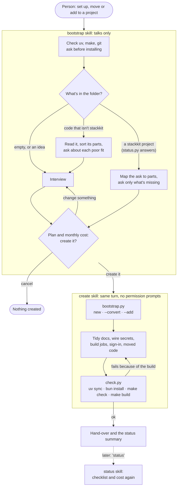

# How stackkit works

How the plugin turns a conversation into a project: the three skills, the scripts they run, the manifest that says what each part touches, and the tests that keep it all honest. For the interview itself, step by step, see [INTERVIEW.md](INTERVIEW.md). The skills' own files are the source of truth; this page explains how they fit together.

## The run, end to end



## Three skills, and why

| Skill | Who starts it | What it does | Commands it may run |
|---|---|---|---|
| [`bootstrap`](../skills/bootstrap/SKILL.md) | The person ("set up a new project") | Works out the job, interviews, agrees a plan. Never builds. | `status.py`, to tell a stackkit project from other code |
| [`create`](../skills/create/SKILL.md) | `bootstrap`, in the turn the plan is confirmed. Hidden from the `/` menu. | Builds, tidies, checks and hands over | `bootstrap.py`, `check.py`, and the file tools |
| [`status`](../skills/status/SKILL.md) | The person, any time ("what's left to set up?") | Prints the checklist and cost estimate. Changes nothing. | `status.py` |

The split exists because a skill's `allowed-tools` approval lasts only for the turn it's invoked in. The interview spans many turns; `create` is invoked in the one turn where the person says yes, so the whole build runs without stopping to ask. That's also why every command `create` runs lives inside one of its two scripts: anything else would prompt a person who can't judge it.

## The scripts

All three are standard library only and run with `uv run --python 3.13 --no-project`. Each prints one JSON object; an `error` key means nothing was written.

| Script | Does |
|---|---|
| [`bootstrap.py`](../skills/create/scripts/bootstrap.py) | **New project:** copies `template/`, removes the modules in `--remove` (and any implicit module nothing kept needs), fills in the name and `.env`, deletes doc lines about removed parts, and lists prose that still mentions them (`leftover_refs`). **`--convert`:** moves the folder's files to `<folder>-before-stackkit` first, keeping `.git`. **`--copy old=new`:** carries moved code in, inside the project's folders only. **`--add`:** grows an existing project (below). |
| [`check.py`](../skills/create/scripts/check.py) | `git init`, `uv lock`, `uv sync`, `bun install` when there's a web page, `make check`, `make build`; stops at the first failure. Ends with `status.py`'s report. |
| [`status.py`](../skills/create/scripts/status.py) | Read-only: which parts the project has, missing tools (with the pinned Java and Node versions), blank `.env` keys and secrets, and the cloud steps left. |

Costs for the summary live in [`skills/create/costs.md`](../skills/create/costs.md). Where each part of a moved project goes is [`skills/create/moving.md`](../skills/create/moving.md); reactions to new files or records, which stackkit doesn't have as a part yet, are built by hand from [`skills/create/reactions.md`](../skills/create/reactions.md).

## The manifest and markers

[`template/stackkit.toml`](../template/stackkit.toml) lists every optional module. Removing one means deleting its `paths`, dropping it from the uv workspace, deleting its `json_keys`, and deleting every block between its markers in the project's text files:

```make
# stackkit:begin jobs
TEST_TARGETS += test-jobs
# stackkit:end jobs
```

A marker that names several modules (`stackkit:begin cloud_run,agents,jobs`) goes only when all of them are removed. The template runs with the markers in place, so `make check` passes in a plain copy.

| Field | Meaning |
|---|---|
| `requires` | Modules a kept module can't work without. Removing one is refused. |
| `requires_any` | At least one must be kept (the database needs a server or jobs to use it). |
| `implicit` | Never asked about; removed once nothing kept requires it (`firebase`, `shared`, `gcp`). |
| `self_contained` | Deploys on its own with its own copies, so other modules' `refs` aren't checked inside it (`jobs`, `agents`). |
| `paths` | Folders and files to delete. A path under `shared/` also goes from every `*_service/` copy. |
| `refs` | Strings that shouldn't survive a removal. Left over in code is a test failure; in prose, `create` rewords it. |
| `only_without` | Fallback files that only matter once the module is gone. |
| `[rules] keep_one_of` | Each group keeps at least one module; a table with `when_kept` applies only when one of those is kept (hosting is only for a server or page). |

## Adding parts to a project

`bootstrap.py --add` renders the template twice into a temporary folder: once with the project's current parts (the base) and once with the added ones (after). Each file that differs is applied to the project:

- new in `after` → copied in (`new_files`), unless the project has a file there (a conflict)
- the project's copy matches base or after → replaced (`updated`)
- the project changed it too → three-way merged (`merged`), or reported with a diff for `create` to apply by hand (`conflicts`)
- gone in `after` → deleted if untouched, otherwise reported

Projects made by older stackkits keep their layout. A folder renamed since (`service/` → `api_service/`, in `status.RENAMED`) is renamed back in both renders before comparing. A folder added since (`shared/`, in `status.ADDED_LATER`) is left out of both renders, so the project keeps its clients in each service. A project whose `app_settings.py` predates the shared `base_settings.py` keeps it, and the fields the new parts would add come back as a conflict with a diff. The root Makefile's service targets depend on `$(SYNC)`, which only projects with `shared/` define, so a target an addition brings works in an older project too.

## Shared code across services

Each `*_service/` folder deploys on its own, so each keeps a copy of the Google clients in `gcp_services/`. `template/shared/gcp_services/` is the one to edit; `shared/sync.sh` (`make sync`) copies it into every service, and every target that runs, tests, builds or deploys a service syncs first. The sync refuses to overwrite a copy that was edited by hand (newer than the shared file, with changes that aren't committed) and names it.

## Tests

`make test-bootstrap` is the test suite. Run it after any change to `template/` or the scripts.

1. **Lint** the scripts and template with ruff, without fixes: a fix that moves imports would move the markers above them.
2. **Check versions:** the pinned Java and Node in `status.py` still satisfy the latest Firebase CLI, and `template/docs/ENVIRONMENTS.md` matches.
3. **Sample projects** (`SAMPLE_SPECS`): between them every module is kept and removed. For each: no `stackkit` left, no removed module mentioned outside Markdown, `make check` and `make build` pass, `status.py` sees the kept parts, `setup_iam.sh` parses, and every service's `gcp_services/` matches `shared/`.
4. **Convert** an existing repo in place, and check the layout and the moved-aside files.
5. **Add** parts to an API-only project and compare it with a fresh project built with them.
6. **Add to an older project**, made by the stackkit at `OLD_STACKKIT`: it gains a database, keeps its layout, reports its settings, and passes `make check`.

## Where things live

| Path | What |
|---|---|
| `skills/bootstrap/` | The interview (`SKILL.md`) and examples to offer when someone is stuck (`examples.md`) |
| `skills/create/` | The build (`SKILL.md`), its scripts, costs, the moving guide and the reactions guide |
| `skills/status/` | The checklist and cost summary |
| `template/` | The product: the runnable stack every project is copied from. Its own `AGENTS.md` covers working inside it. |
| `dev/` | Helpers for `make test-bootstrap` (`check_docs.py`, `check_versions.py`) |
| `docs/research/` | Research charter and findings behind the design |
| `docs/reviews/` | Code reviews of branches, kept as a record |
