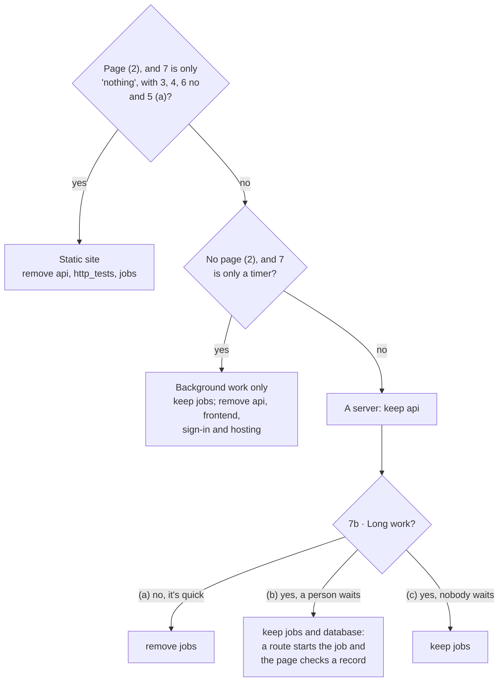

# The interview

What the `stackkit` skill asks, in what order, and which answers skip which questions. [`skills/stackkit/SKILL.md`](../skills/stackkit/SKILL.md) is the source of truth: its step 3 table holds the exact wording, the default to offer, and the plain-words explanation for each question. Change this page in the same commit as the skill.

Question 2 (opened in a browser) is yes for nearly everyone. When it's asked, its No option warns that no means only the behind-the-scenes part, a server other programs talk to and its database, for people who know what that means. A brief for work that runs on its own ("every morning, read a site and save a report") answers it without asking.

Question 5 (who can open it) leans internal: when anyone signs in, the team-only option is recommended, since it's the easiest, with nothing to build. Letting outsiders in (a staff area on a public site, or customer accounts) needs a good reason, like the public having to book or order, or customers coming back to their own things.

Every question is skipped when the brief, the code being moved, or the project being added to already answers it. Some are never asked for a new project: the name, the folder, and when a timer runs are assumed. Everything assumed goes in a **What I assumed** list in the confirmation, where "Change something" fixes it. Questions with choices are asked one at a time, with the recommended answer first.

## The questions

```mermaid
flowchart TD
    Q1["1 · What should it do, and for whom?<br/><i>the brief</i>"] --> Q2{"2 · Opened in a<br/>web browser?"}
    Q2 -- yes --> Q3
    Q2 -- no --> Q7e{"7 · What starts the work?<br/><i>asked early</i>"}
    Q7e -- "only a person" --> Q3
    Q7e -- "a timer, or something<br/>arriving" --> Q7d{"7d · Where should<br/>the result go?"}
    Q7d -- "only a timer:<br/>background work only" --> Q6
    Q7d -- otherwise --> Q3

    Q3{"3 · Remembers things<br/>between visits?"} --> Q4{"4 · People upload<br/>or keep files?"}
    Q4 --> Q5{"5 · Who can open it?"}
    Q5 -- "(a) anyone" --> Q6
    Q5 -- "(b) staff area" --> Q5c
    Q5 -- "(c) team only" --> Q5b{"5b · Outsiders too?"}
    Q5 -- "(d) customer accounts" --> Q6
    Q5b -- no --> Q5c["5c · Staff email ending<br/>or addresses"]
    Q5b -- "yes: let in one by one" --> Q5d
    Q5c -- "after (c)" --> Q5d{"5d · Google sign-in set up<br/>for another app already?"}
    Q5c -- "after (b)" --> Q6
    Q5d --> Q6

    Q6{"6 · Will users need AI<br/>to generate content?"} -- yes --> Q6b{"6b · One job when asked,<br/>or an assistant?"}
    Q6 -- no --> BGQ
    Q6b --> BGQ{"Background<br/>work only?"}
    BGQ -- yes --> Q7c
    BGQ -- no --> Q7

    Q7{"7 · What starts it?<br/>a person · something arrives · a timer · nothing<br/><i>skipped if asked early</i>"}
    Q7 -- "a person, something<br/>arrives, or a timer" --> Q7b{"7b · Longer than<br/>a minute?"}
    Q7 -- "nothing: it shows information" --> SRV
    Q7b --> Q7c["7c · Outside services with a key,<br/>or a site behind a sign-in<br/><i>skipped when all public</i>"]
    Q7c --> SRV{"Is there a server?"}

    SRV -- yes --> Q8{"8 · Its own web address,<br/>or Google's?"}
    Q8 -- "own, and replies<br/>should stream" --> Q8b{"8b · Replies all at<br/>once: okay?"}
    Q8 -- otherwise --> Q9
    Q8b --> Q9{"9 · Cheapest, or<br/>always ready?"}
    Q9 --> AS
    SRV -- no --> AS

    AS["Assumed, not asked<br/>10 · the name · 11 · the folder<br/>when a timer runs, in the computer's time zone"] --> Q12{"12 · Who puts it online?"}
    Q12 --> C(["Confirm: the plan, What I assumed,<br/>and the monthly cost"])
```

For background work only, nobody opens anything, so questions 3, 4, 5, 7b, 8 and 9 don't apply: 7d decides whether there's file storage. Question 7c is asked only when there's a server or background work, and only when something it uses isn't public. When moving a project, question 11 is asked, since the folder is a real choice.

### Example: "every morning, read example.com and summarize it into a report"

The brief answers 1, 2 (no page), 7 (a timer) and 6 (AI, one job). A report with nowhere else named is saved as a file (7d), so Claude asks only 12 (who puts it online). It assumes the rest and confirms:

> **Daily Example Summary**, in `~/projects/daily-example-summary`
> - Every morning, reads example.com and has AI write a short report
> - Saves each report as a file you can open, in a space at Google for the project's files
> - Nothing to open, no sign-in, no server
>
> **What I assumed:** it runs at 7am, New York time; each report is saved as a file; example.com is public, so it needs no key; the name and folder above.

## What each answer keeps or removes

| Question | Answer | Effect |
|---|---|---|
| 2 | no | remove `frontend` |
| 3 | no | remove `database` |
| 4 | no | remove `storage` |
| 5 | (a) anyone | remove `auth_iap` and `auth_firebase` |
| 5 | (b) staff area, (d) customer accounts | keep `auth_firebase`, remove `auth_iap` |
| 5 | (c) team only | keep `auth_iap`, remove `auth_firebase` |
| 5c | an email ending or addresses | `VALID_DOMAINS` in `.env` |
| 6 | no | remove `ai` and `agents` |
| 6b | (a) one job | keep `ai`, remove `agents` |
| 6b | (b) an assistant | keep `ai`, `agents` and `database` |
| 7, 7b | see below | `api`, `jobs` |
| 7c | each service | the names of its keys, wired into `SECRET_KEY_NAMES` and `setup_iam.sh` |
| 7d | (a) a file (assumed for a report) | keep `storage` |
| 7d | (b) an app they use | that app's key names (a Google Sheet needs none) |
| 7d | (c) a page | keep `frontend`, `api` and `database` |
| 8 | own address / Google's | remove `cloud_run` / remove `gae` |
| 9 | cheapest / always ready | remove `always_on` / keep it |
| 10, 11 (assumed) | | `--display-name`, `--name`, `NAMESPACE`, `--dest`, or `--convert` |
| when a timer runs (assumed) | from the brief, in the computer's time zone | the job's timer in `job_service/job_service.toml` |
| 12 | someone else, or not sure / me | the hand-over includes a note to send / the steps themselves |

Without asking: `notebooks` is removed, `http_tests` goes with `api`, and any kind of sign-in keeps `api`. A static site always goes on App Engine (no `cloud_run`, no `always_on`).

## The server or background work

Questions 2, 7 and 7b decide whether there's a server (`api`), background work (`jobs`), both, or neither.

Something on a schedule that's quick, on a project with a server, is a server route with a make target, started by a timer at Google once it's online. Long work, or a project with no server, is a job. A new file or record arriving (7, "something arrives") is a reaction: stackkit doesn't have that part yet, so `create` builds a first version by hand from [`reactions.md`](../skills/create/reactions.md), and keeps the part it watches (`storage` or `database`).

## Moving or adding

**Moving a project onto stackkit:** the database stays server-only. If the old app reads or writes its database from the browser, those calls move onto the server, and the confirmation says so; the person needs a good reason to keep browser access. Claude reads the old code first, says what it found (that becomes the brief), sorts every part into "as it is", "with changes" and "needs a decision", asks about each decision, and then asks only the questions above that the code didn't answer. Question 11 is always asked, as a choice of folder. See [`skills/create/moving.md`](../skills/create/moving.md).

**Adding to a stackkit project:** `status.py` says which parts it has. Claude maps the request to parts and asks only the questions for the parts being added, plus 12 when there's new setup at Google. It skips 10 and 11: the project keeps its name and folder. Adding can't remove a part, switch hosting or rename the project.
