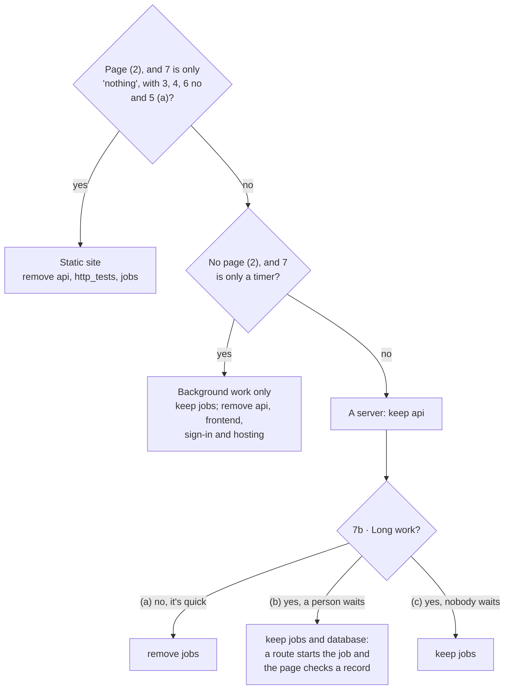

# The interview

What the `bootstrap` skill asks, in what order, and which answers skip which questions. [`skills/bootstrap/SKILL.md`](../skills/bootstrap/SKILL.md) is the source of truth: its step 3 table holds the exact wording, the default to offer, and the plain-words explanation for each question. Change this page in the same commit as the skill.

Every question is skipped when the brief, the code being moved, or the project being added to already answers it; Claude says what it assumed instead. Questions with choices are asked one at a time with the recommended answer first.

## The questions

```mermaid
flowchart TD
    Q1["1 · What should it do, and for whom?<br/><i>the brief</i>"] --> Q2{"2 · Opened in a<br/>web browser?"}
    Q2 -- yes --> Q3
    Q2 -- no --> Q7e{"7 · What starts the work?<br/><i>asked early</i>"}
    Q7e -- "only a timer" --> BG["Background work only<br/><i>skip 5, 8 and 9</i>"] --> Q3
    Q7e -- "anything else" --> Q3

    Q3{"3 · Remembers things<br/>between visits?"} --> Q4{"4 · People upload<br/>or keep files?"}
    Q4 --> Q5{"5 · Who can open it?"}
    Q5 -- "(a) anyone" --> Q6
    Q5 -- "(b) staff area" --> Q5c
    Q5 -- "(c) team only" --> Q5b{"5b · Outsiders too?"}
    Q5 -- "(d) customer accounts" --> Q6
    Q5b -- no --> Q5c["5c · Staff email ending<br/>or addresses"]
    Q5b -- "yes: let in one by one" --> Q5d
    Q5c -- "after (c)" --> Q5d{"5d · Google sign-in set up<br/>for another app already?"}
    Q5c -- "after (b)" --> Q6
    Q5d --> Q6

    Q6{"6 · Use AI?"} -- yes --> Q6b{"6b · One job when asked,<br/>or an assistant?"}
    Q6 -- no --> Q7
    Q6b --> Q7

    Q7{"7 · What starts it?<br/>a person · something arrives · a timer · nothing<br/><i>skipped if asked early</i>"}
    Q7 -- "a person, something<br/>arrives, or a timer" --> Q7b{"7b · Longer than<br/>a minute?"}
    Q7 -- "nothing: it shows information" --> SRV
    Q7b --> Q7c["7c · Outside services<br/>that give a key"]
    Q7c --> SRV{"Is there a server?"}

    SRV -- yes --> Q8{"8 · Its own web address,<br/>or Google's?"}
    Q8 -- "own, and replies<br/>should stream" --> Q8b{"8b · Replies all at<br/>once: okay?"}
    Q8 -- otherwise --> Q9
    Q8b --> Q9{"9 · Cheapest, or<br/>always ready?"}
    Q9 --> Q10
    SRV -- no --> Q10

    Q10["10 · The name"] --> Q11["11 · Which folder"] --> Q12{"12 · Who puts it online?"}
    Q12 --> C(["Confirm: plan and monthly cost"])
```

Question 5 is skipped for background work only, since nobody opens it. Question 7c is asked only when there's a server or background work.

## What each answer keeps or removes

| Question | Answer | Effect |
|---|---|---|
| 2 | no | remove `frontend` |
| 3 | no | remove `database` |
| 4 | no | remove `storage` |
| 5 | (a) anyone | remove `auth_iap` and `auth_firebase` |
| 5 | (b) staff area, (d) customer accounts | keep `auth_firebase`, remove `auth_iap` |
| 5 | (c) team only | keep `auth_iap`, remove `auth_firebase` |
| 5c | an email ending or addresses | `VALID_DOMAINS` in `.env` |
| 6 | no | remove `ai` and `agents` |
| 6b | (a) one job | keep `ai`, remove `agents` |
| 6b | (b) an assistant | keep `ai`, `agents` and `database` |
| 7, 7b | see below | `api`, `jobs` |
| 7c | each service | the names of its keys, wired into `SECRET_KEY_NAMES` and `setup_iam.sh` |
| 8 | own address / Google's | remove `cloud_run` / remove `gae` |
| 9 | cheapest / always ready | remove `always_on` / keep it |
| 10, 11 | | `--display-name`, `--name`, `NAMESPACE`, `--dest`, or `--convert` |
| 12 | someone else, or not sure / me | the hand-over includes a note to send / the steps themselves |

Without asking: `notebooks` is removed, `http_tests` goes with `api`, and any kind of sign-in keeps `api`. A static site always goes on App Engine (no `cloud_run`, no `always_on`).

## The server or background work

Questions 2, 7 and 7b decide whether there's a server (`api`), background work (`jobs`), both, or neither.

Something on a schedule that's quick, on a project with a server, is a server route with a make target, started by a timer at Google once it's online. Long work, or a project with no server, is a job. A new file or record arriving (7, "something arrives") is a reaction: stackkit doesn't have that part yet, so `create` builds a first version by hand from [`reactions.md`](../skills/create/reactions.md), and keeps the part it watches (`storage` or `database`).

## Moving or adding

**Moving a project onto stackkit:** Claude reads the old code first, says what it found (that becomes the brief), sorts every part into "as it is", "with changes" and "needs a decision", asks about each decision, and then asks only the questions above that the code didn't answer. Question 11 is always asked, as a choice of folder. See [`skills/create/moving.md`](../skills/create/moving.md).

**Adding to a stackkit project:** `status.py` says which parts it has. Claude maps the request to parts and asks only the questions for the parts being added, plus 12 when there's new setup at Google. It skips 10 and 11: the project keeps its name and folder. Adding can't remove a part, switch hosting or rename the project.
