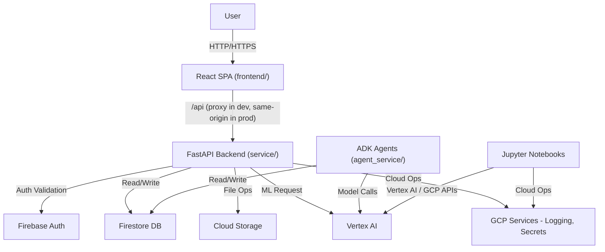
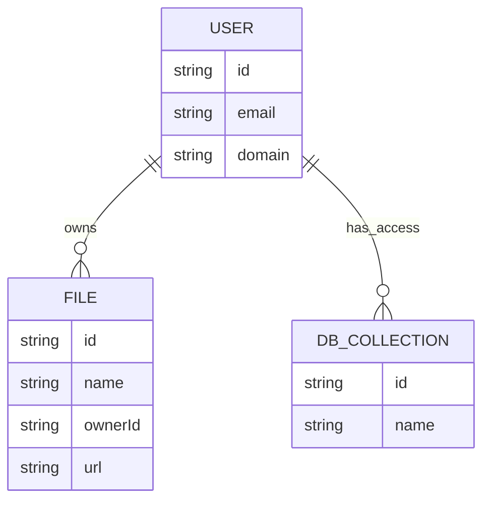
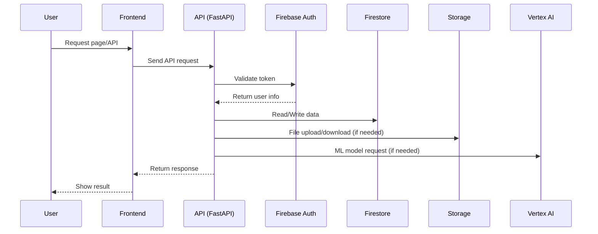

# Architecture

## Overview

FastAPI backend with Firebase services (Auth, Firestore, Storage), Vertex AI for ML capabilities, and Google ADK for agent definitions. Supports dual-mode operation: local development with emulators and cloud deployment on GCP.

## System Diagram



The SPA is built into `service/static/` at deploy time, so in production the frontend and API are the same origin. In development `FRONT_END_URL` switches FastAPI into redirect mode and Vite proxies `/api` back to port 8000. The agents deploy separately and never route through the FastAPI service.

## Application Structure

| Directory | Purpose |
|-----------|---------|
| `service/` | FastAPI backend (entry: `app.py`) |
| `service/api/` | API routes (`router.py`) and app wiring (`config_app.py`) |
| `service/gcp_services/` | GCP/Firebase service integrations — source of truth |
| `service/gcp_services/clients/` | Pre-configured Firebase clients |
| `service/tests/` | pytest test suite for the service |
| `agent_service/` | Self-contained ADK deploy unit — own settings, own `gcp_services/` |
| `agent_service/agents/` | Google ADK agent definitions |
| `agent_service/gcp_services/` | Synced copy of `service/gcp_services/` (see Service Boundaries) |
| `agent_service/tests/` | pytest test suite for the agents |
| `frontend/` | React 19 SPA (Vite, Tailwind v4, shadcn/ui) |
| `gcp/` | Emulator orchestration, Firestore rules/indexes, IAM scripts, `gcp` CLI |
| `notebooks/` | ML experimentation with Vertex AI |

### Service Boundaries

`service/` and `agent_service/` are separate uv workspace packages that deploy independently — the service to App Engine or Cloud Run, the agents to Agent Engine or Cloud Run. They share GCP integration code by **copy, not import**: `make sync-agents` rsyncs `service/gcp_services/` into `agent_service/gcp_services/`, excluding `clients/gcp_services.py` so the agents keep their own Firestore-only client override.

The copy exists because each package installs its own dependency set and deploys from its own directory; a shared import would drag the service's FastAPI and Storage dependencies into every agent deploy. The cost is that `service/gcp_services/` is the only place to edit these files — changes made in `agent_service/gcp_services/` are overwritten on the next sync.

## Data Model



- Users are authenticated via Firebase Auth
- Files are stored in Firebase Storage and linked to users
- Firestore collections are accessed by users (schema is dynamic)

## Request Sequence



## Key Modules

| Module | Purpose | Location |
|--------|---------|----------|
| `gcp_services` | Firebase client factory | `service/gcp_services/clients/gcp_services.py` |
| `app_settings` | Dual-mode configuration | `service/app_settings.py` |
| `fb_auth` | Firebase Auth decorator and validation | `service/gcp_services/clients/fb_auth.py` |
| `iap_auth` | IAP identity decorator and middleware | `service/gcp_services/clients/iap_auth.py` |
| `config_app` | CORS, static mount, SPA fallback, warmup route | `service/api/config_app.py` |
| `router` | API routes (prefix `/api`) | `service/api/router.py` |
| `agents` | ADK agent definitions | `agent_service/agents/` |
| `deploy` | Agent Engine deployment | `agent_service/deploy.py` |
| `cli` | GCP tooling CLI (Typer) | `gcp/cli.py`, commands in `gcp/commands/` |

### GCP Services

Pre-configured clients that auto-detect emulator mode:

```python
from gcp_services.clients.gcp_services import db, bucket, auth_client
```

- `db` - Firestore async client
- `bucket` - Cloud Storage bucket
- `auth_client` - Firebase Auth client

### Dual-Mode Configuration

`app_settings.py` handles environment detection:

- **Local**: Uses emulators when `USE_EMULATOR=true` in `.env`
- **Cloud**: Auto-detects GCP via `K_SERVICE` or `GAE_INSTANCE` env vars
- **Settings cascade**: `.env` → environment variables → GCP defaults

### Authentication

Two interchangeable options live in `service/gcp_services/clients/`. Both check the
email domain against `settings.valid_domains` (`VALID_DOMAINS` env, default
blank, which allows any domain) and attach the caller to
`request.state.user`.

**Firebase Auth** (`fb_auth.py`) - the frontend signs in with Firebase and sends an
ID token. `@firebase_auth_required()`:

1. Extracts Bearer token from Authorization header
2. Validates against Firebase Auth
3. Checks the email domain
4. Attaches `user` dict (`uid`, `email`, `display_name`, `admin`, `claims`)

**Identity-Aware Proxy** (`iap_auth.py`) - IAP sits in front of the service (Cloud Run
`--iap`, or App Engine behind IAP) and forwards a signed `x-goog-iap-jwt-assertion`.
The module verifies it against Google's IAP keys and the service's audience, then
attaches an `Identity` (`email`, `sub`, `source`). Apply it either way:

- `@iap_auth_required()` on a single endpoint, mirroring the Firebase decorator
- `app.add_middleware(IdentityMiddleware)` to protect every `/api/` path except
  `/api/healthcheck/`

Deployed, the audience is `IAP_AUDIENCE` if set, otherwise derived once from the
Cloud Run metadata server and `K_SERVICE`; an unknown audience fails closed with 401.
Locally there is no IAP, so `LOCAL_USER_EMAIL` in `.env` is the identity (ignored on
deployed instances).

### API Routes

All routes are registered on `api_router` in `service/api/router.py` under the `/api` prefix.

| Route | Method | Auth | Purpose |
|-------|--------|------|---------|
| `/api/` | GET | `@firebase_auth_required()` | Hello-world / auth smoke check |
| `/api/query/` | POST | none | Echoes `text` from the request body |
| `/api/healthcheck/` | GET | none | Liveness probe |
| `/api/file-list/` | GET | none | Lists blob names in the Storage bucket |
| `/api/db-list/` | GET | none | Lists Firestore collection IDs |

Registered outside the router in `app.py` / `config_app.py`: `/api/docs`, `/api/redoc` and `/api/scalar` (API reference, schema at `/api/openapi.json`, all under the IAP-protected prefix), `/_ah/warmup` (App Engine warmup), and either a catch-all redirect to `FRONT_END_URL` or the SPA served from `service/static/` via FastAPI's `app.frontend()` (files served directly, `index.html` fallback for browser navigations, 404 otherwise).

### ADK Agents

Each agent folder under `agent_service/agents/` contains:
- `agent.py` - Agent definition using `Agent()` class
- `prompt.py` - Agent prompts and instructions

Must export `root_agent` in each agent module.

## External Integrations

| Integration | Purpose | Auth Method |
|-------------|---------|-------------|
| Firebase Auth | User authentication | Bearer tokens |
| Firestore | Document database | Service account / emulator |
| Cloud Storage | File storage | Service account / emulator |
| Vertex AI | ML model inference | Service account |
| Secret Manager | Secrets storage | Service account |
| Cloud Logging | Structured logging | Service account |

## Design Decisions

| Decision | Choice | Rationale |
|----------|--------|-----------|
| Async operations | `async/await` | Better concurrency for I/O-bound operations |
| Dual-mode config | Environment detection | Seamless local/cloud development |
| Firebase emulators | Local development | No cloud costs, offline capability |
| ADK agents | Google ADK | Native GCP integration, Vertex AI support |
| Agent packaging | Separate uv package, code synced by copy | Keeps FastAPI/Storage dependencies out of the agent deploy; the alternative — one package importing shared code — makes every agent deploy carry the whole service |
| Frontend delivery | Built into `service/static/` | One deploy unit and same-origin requests in production; the alternative is a second hosting target plus CORS |

## Related Documentation

- [README.md](../Readme.md) - Project overview
- [ENVIRONMENTS.md](./ENVIRONMENTS.md) - Environment configuration
- [CLOUD.md](./CLOUD.md) - GCP setup and deployment
