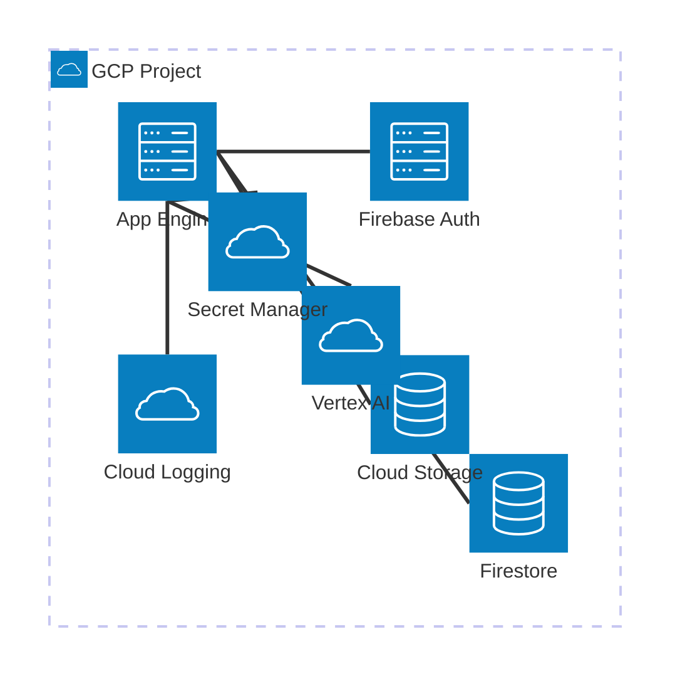
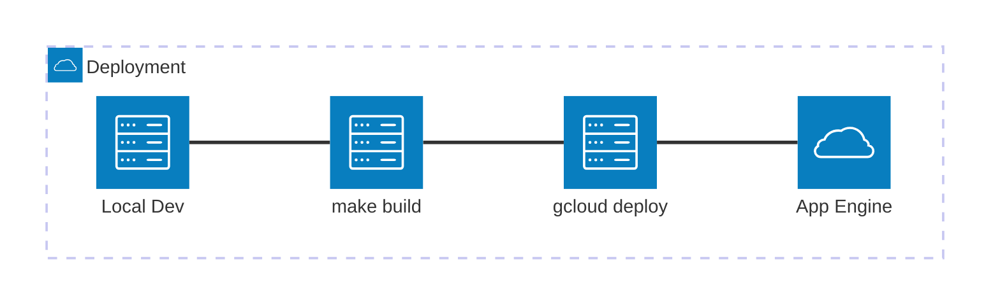

# Cloud Infrastructure

## Overview

| Attribute | Value |
|-----------|-------|
| Provider | Google Cloud Platform |
| Project | [TODO: Add project ID] |
| Region | us-central1 |
| Deployment | App Engine |

## Architecture Diagram



## Services Used

| Service | Purpose | Config Location |
|---------|---------|-----------------|
| App Engine | Service hosting (default target) | `service/app.yaml`, routing in `gcp/dispatch.yaml` |
| Cloud Run | Alternative service target, and a target for the agents | `make deploy-cr` / `make deploy-agent-cr` flags |
| Agent Engine | ADK agent hosting | `agent_service/deploy.py` |
| Firebase Auth | User authentication | Firebase Console |
| Firestore | Document database | `gcp/firestore.rules`, `gcp/firestore.indexes.json` |
| Cloud Storage | File storage | `gcp/storage.rules`, CORS in `gcp/cors.json` |
| Vertex AI | ML model inference | Code |
| Secret Manager | Secrets storage | GCP Console; access granted by `gcp/bin/setup_iam.sh` |
| Cloud Logging | Application logs | Automatic |

## GCP Project Setup

### 1. Create GCP Project

Create a new project in [Google Cloud Console](https://console.cloud.google.com).

### 2. Enable Firebase

1. Go to [Firebase Console](https://console.firebase.google.com)
2. Add Firebase to existing GCP project
3. Enable required services:
   - **Authentication**: Enable desired sign-in methods
   - **Firestore**: Create database (name: `(default)` for single DB)
   - **Storage**: Create default bucket

### 3. Enable APIs

Enable required APIs in GCP Console:

- Cloud Logging API
- Secret Manager API
- Vertex AI API

### 4. LLM Authentication (no API key)

Gemini calls go through Vertex AI using Application Default Credentials. There is no API key anywhere in the project, and none should be added (see constitution Service Pattern VI).

- **Local**: `gcloud auth application-default login`. Both `app_settings.py` files set `GOOGLE_GENAI_USE_VERTEXAI=true` and `GOOGLE_CLOUD_PROJECT`, so the FastAPI service and `adk web` both use your ADC.
- **Cloud**: the runtime service account. It needs `roles/aiplatform.user`; the App Engine default SA's Editor role covers this unless it has been pruned.

If you have a leftover `GOOGLE_API_KEY` in `.env`, remove it. The genai client ignores it once the Vertex flag is set, but it is misleading and invites key-based code.

## Deployment

### CI/CD Pipeline



### Deploy Targets

Each target builds first — you don't need a separate `make build`.

| Target | Deploys | To |
|--------|---------|-----|
| `make deploy-app` | `service/` | App Engine (`gcloud app deploy service/app.yaml`) |
| `make deploy-cr` | `service/` | Cloud Run, from source, `--no-allow-unauthenticated` |
| `make deploy-agent` | `agent_service/` | Agent Engine, via `agent_service/deploy.py` |
| `make deploy-agent-cr` | `agent_service/` | Cloud Run, via `adk deploy cloud_run --with_ui` |

`make deploy-app` runs frontend build → `frontend/dist/` copied to `service/static/` → `requirements.txt` exported from the lockfile → `gcloud app deploy`.

**New versions do not take traffic automatically.** The App Engine target passes `--no-promote` and names the version from `VERSION` (default `main`), so a deploy is a staged version you promote deliberately.

```bash
VERSION=my-branch make deploy-app     # deploy a named version
gcloud app versions list              # see what's deployed
gcloud app versions migrate VERSION_ID  # send traffic to it
```

### Manual Deployment

```bash
cd service
make build              # export requirements.txt
gcloud app deploy app.yaml --project=$PROJECT_ID
```

### Rollback

```bash
# List versions
gcloud app versions list

# Route traffic to previous version
gcloud app versions migrate VERSION_ID
```

### Infrastructure Targets

Run from `gcp/`.

| Command | Purpose |
|---------|---------|
| `make setup-iam` | Grant the App Engine service account its runtime roles (see Security) |
| `make rules` | Deploy `firestore.rules` |
| `make indexes` | Deploy `firestore.indexes.json` |
| `make indexes-save` | Write the live index config back to `firestore.indexes.json` |
| `make cors` | Apply `cors.json` to the Storage bucket |
| `make dispatch` | Deploy `dispatch.yaml` routing rules |
| `make sync-db` | Pull cloud Firestore data into `gcp/firestore_data` for the emulator |

### GCP Tooling CLI

`gcp/cli.py` is a Typer CLI for one-off cloud operations. It loads the root `.env` before dispatching, so commands inherit `PROJECT_ID` and `NAMESPACE`.

```bash
cd gcp && make cli ARGS="--help"
cd gcp && make cli ARGS="split-cookie https://your-app.appspot.com/ -n 5000"

# or directly from the repo root
uv run gcp/cli.py split-cookie https://your-app.appspot.com/
```

| Command | Purpose |
|---------|---------|
| `split-cookie` | Detect an App Engine cookie-based traffic split — sweeps `GOOGAPPUID` 0-999 for the deterministic shard map, samples uncookied requests for the live split, and diffs the minority page against the majority |

`split-cookie` is the tool for verifying a `--no-promote` deploy: it finds a `GOOGAPPUID` value that reliably routes you to the new version so you can view it before migrating traffic.

## Security

### Service Accounts

App Engine runs as the default service account, `<project-id>@appspot.gserviceaccount.com`. It does **not** get Secret Manager or token-signing access by default — those must be granted explicitly:

```bash
cd gcp && make setup-iam    # or: bash gcp/bin/setup_iam.sh
```

The script reads `PROJECT_ID` from the root `.env` and grants:

| Role | Purpose | Scope |
|------|---------|-------|
| `roles/secretmanager.secretAccessor` | Read secrets at startup (`load_secrets()`) | Per-secret, for each name in the script's `SECRETS` array |
| `roles/iam.serviceAccountTokenCreator` | Sign GCS URLs for Storage operations | On the service account itself |

Firestore, Storage, and Vertex AI access come with the default service account's project-level roles. Adding a secret means editing both `SECRET_KEY_NAMES` in `service/app_settings.py` and the `SECRETS` array in `gcp/bin/setup_iam.sh`, then re-running the script before deploying.

### Storage Bucket CORS

Browser access to the bucket (signed-URL downloads, image loads) needs a CORS policy. It lives in `gcp/cors.json` and is applied with:

```bash
cd gcp && make cors
```

The current policy allows `GET` from any origin with a one-hour cache. Restrict `["*"]` to specific domains in `gcp/cors.json` before production use.

### Domain Whitelisting

Both auth options check the email domain against `settings.valid_domains`
(`VALID_DOMAINS` env var, comma separated, default blank). Leave it blank
(`VALID_DOMAINS=`) to disable the check and allow any Google account:

- `@firebase_auth_required()` - valid Firebase Auth token, then domain check
- `@iap_auth_required()` / `IdentityMiddleware` - valid IAP JWT assertion for this
  service's audience, then domain check

### IAP Identity

When the service runs behind Identity-Aware Proxy (Cloud Run `--iap`), IAP handles
sign-in and forwards `x-goog-iap-jwt-assertion`. `iap_auth.py` verifies it against
`https://www.gstatic.com/iap/verify/public_key` and the audience
`/projects/<number>/locations/<region>/services/<service>`, which is derived from the
metadata server at first request. Set `IAP_AUDIENCE` to override, for example on App
Engine (`/projects/<number>/apps/<project-id>`). Locally set `LOCAL_USER_EMAIL` in
`.env`; it is ignored when deployed.

### IAP First-Time Setup

> **IAP deployments only.** Run once per Google Cloud project by whoever looks after it
> (it needs project owner rights). Nothing here runs on its own.

One custom OAuth client serves every IAP site in the project; its ID and secret live in
Secret Manager as `IAP_OAUTH_CLIENT_ID` and `IAP_OAUTH_CLIENT_SECRET`. Access is plain
IAM: the role `roles/iap.httpsResourceAccessor`, no code and no allowlist in the app.

If someone has already set up sign-in for the project, skip to step 4.

```bash
cd gcp
make iap-prepare    # 1. enable IAP; prints the console steps for 2
make iap-client     # 3. save the OAuth client ID and secret to Secret Manager
make iap-apply      #    point the whole project's IAP at that client
make iap-grant MEMBER=group:team@example.com SCOPE=project          # 4. your own team, every site
make iap-grant MEMBER=user:client@example.com                       #    one person, this site only
```

2. **Console, no command exists.** Google Auth Platform: set the app name and support
   email (Branding), choose the Audience, then create a *Web application* client named
   "IAP" and add the redirect URI `https://iap.googleapis.com/v1/oauth/clientIds/CLIENT_ID:handleRedirect`.
   - **Internal**: only people in your Google Workspace organization can sign in.
   - **External**: any Google account can sign in, and IAM decides who gets through. Use it
     when clients or other outsiders need access. Google Workspace isn't required.

#### Handing this to an admin

For someone who doesn't look after Google Cloud, send this to whoever does:

> Please set up Google sign-in (Identity-Aware Proxy) for the Google Cloud project `<PROJECT_ID>`, one time. You need owner rights. In the project's `gcp/` folder run `make iap-prepare`, follow the console steps it prints, then run `make iap-client`, `make iap-apply`, and `make iap-grant MEMBER=group:team@example.com SCOPE=project`. Add outside people one at a time with `make iap-grant MEMBER=user:client@example.com`. Details: the "IAP First-Time Setup" section of `docs/CLOUD.md`.

Grant your own groups at the project level and each outside person on the one site they
should see, so one client can't open another's site. `SCOPE=project` reaches every IAP
site in the project. `make iap-prepare` and `make iap-grant` need the site deployed first
for App Engine, and for Cloud Run the service name is `NAMESPACE`.

IAP with other identity providers (Microsoft, SAML, email and password) needs Identity
Platform and is not set up here; use Firebase Auth when people sign themselves up.

### IAP Sessions and Long-Open Tabs

> **IAP deployments only.** Apps that use Firebase Auth alone don't need this: the
> Firebase SDK refreshes its own tokens and nothing sits in front of the service to
> redirect requests.

IAP's session cookie expires after a while. Once it does, IAP answers every request by
redirecting to Google sign-in. A top-level page load follows that redirect and signs the
user back in. Script, stylesheet, and `fetch` requests can't: the browser blocks the
cross-origin redirect, so a tab restored after a long idle goes blank and API calls fail
with vague network errors.

Two fixes, use both:

1. **Serve the HTML page with `Cache-Control: no-store`.** Hashed assets under
   `/assets/` can stay cached. A returning tab then reloads the page itself through
   IAP, which signs the user in again, usually without a prompt.
2. **Send `X-Requested-With: XMLHttpRequest` on every API call.** IAP then returns a
   `401` instead of a redirect. Catch `401` in one place (for example the React Query
   `QueryCache` / `MutationCache` `onError`) and show a single "Signed out, reload"
   notice with a Reload button.

Cold starts are unrelated: they add a few seconds to the first request and never blank
the page.

Neither fix is wired into the boilerplate yet; add them when a project deploys behind
IAP. See Google's [Managing IAP sessions](https://docs.cloud.google.com/iap/docs/sessions-howto)
and the [IAP FAQ](https://docs.cloud.google.com/iap/docs/faq) on `401` vs `302`.

## Monitoring & Logging

### Logging

| Log Type | Location |
|----------|----------|
| Application logs | Cloud Logging |
| Request logs | App Engine logs |
| Error reports | Error Reporting |

View logs:
```bash
gcloud app logs tail -s default
```

Or in [Logs Explorer](https://console.cloud.google.com/logs).

### Monitoring

- App Engine dashboard shows request latency, error rates
- Cloud Monitoring for custom metrics and alerts

## Optional: LangSmith Integration

For LangChain tracing (requires approval for external data storage):

1. Get API key from [LangSmith](https://smith.langchain.com)
2. Store in Secret Manager
3. Set in `.env`:
   ```
   LANGCHAIN_TRACING_V2=true
   ```

## Related Documentation

- [README.md](../Readme.md) - Project overview
- [ENVIRONMENTS.md](./ENVIRONMENTS.md) - Environment configuration
- [ARCHITECTURE.md](./ARCHITECTURE.md) - Application architecture
